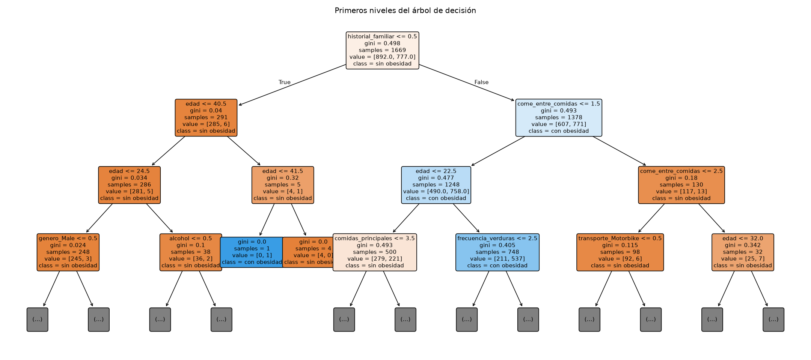
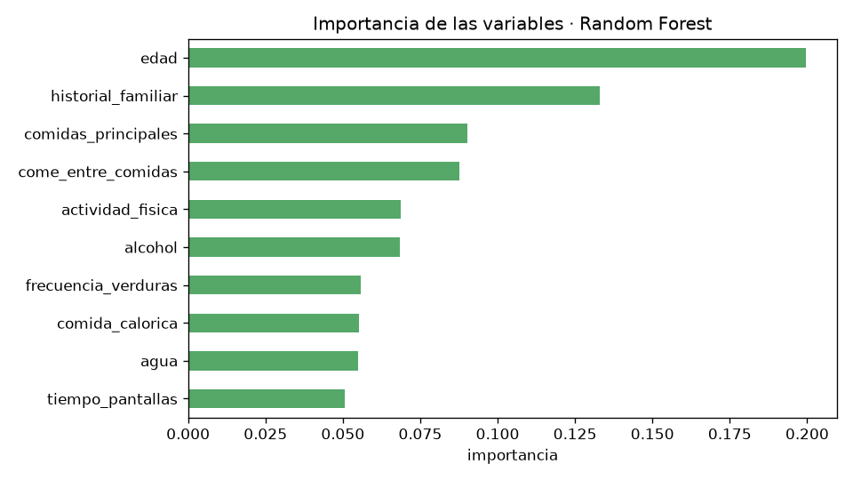
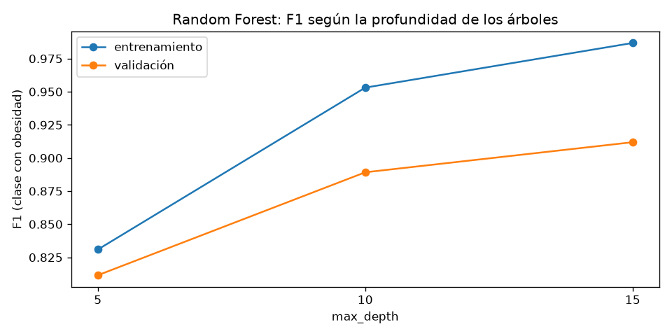
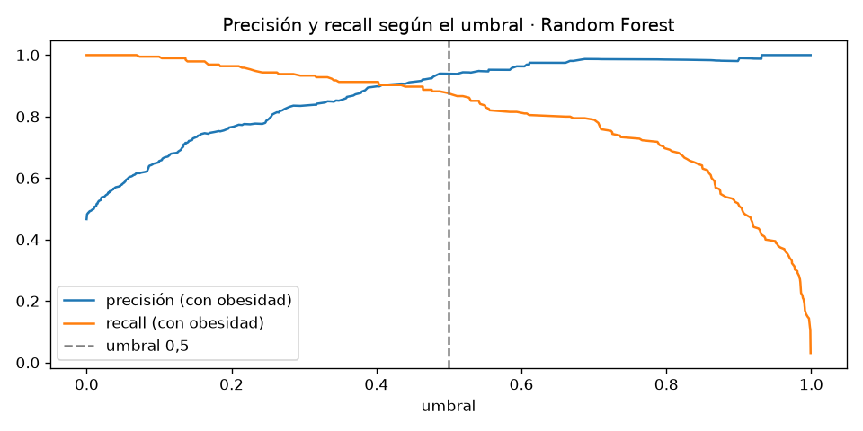
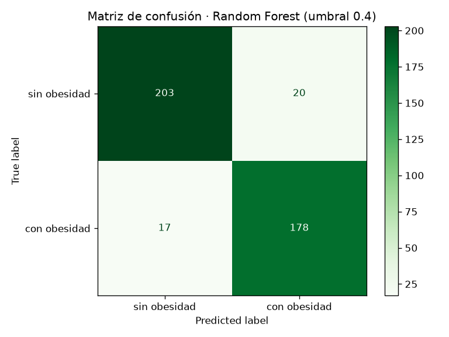
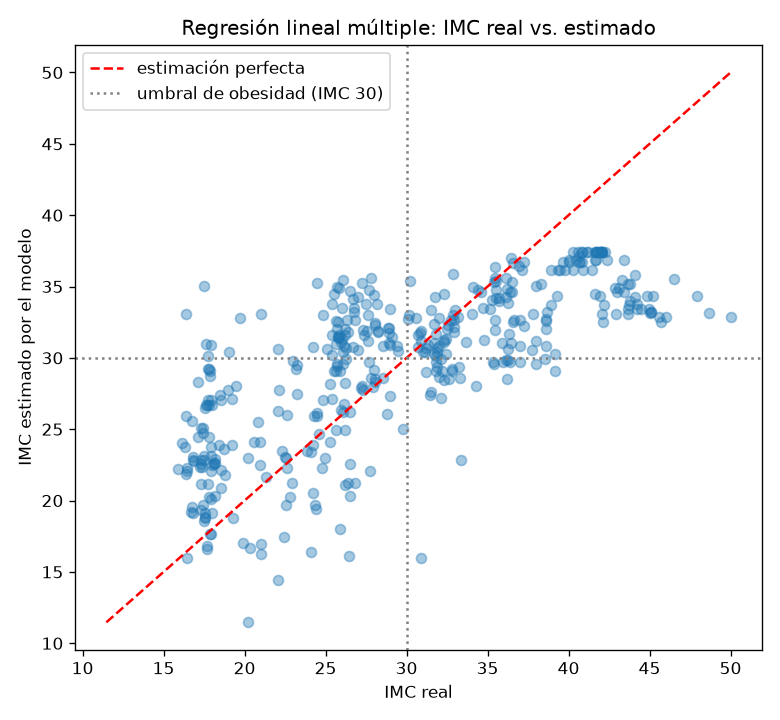
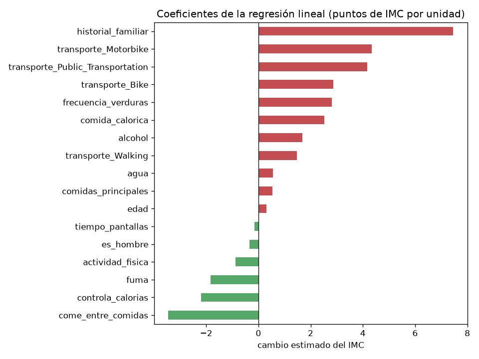

# EA3 – Documento de hallazgos

**Integrantes:** Mayerly Andrea Suarez León, Esteban Urrutia Bermudez y Maycol Alejandro Vasquez Casas.

**Pregunta de negocio:** ¿qué hábitos de alimentación y de actividad física permiten identificar a las personas con obesidad, para que una EPS priorice a quién incluir en sus programas de prevención y acompañamiento nutricional?

**Modelos:** dos modelos supervisados sobre el mismo dataset. Un modelo de **clasificación** (Random Forest) identifica **quién** tiene obesidad, y un modelo de **regresión lineal** estima el **índice de masa corporal (IMC)** y muestra **cuántos puntos** suma o resta cada hábito.

**Dirigido a:** el área de promoción y prevención de una EPS.

Las cifras de este documento salen de la ejecución del notebook `EA3_modelo.ipynb`, del resumen automático `reportes/EA3_resumen_modelo.txt` y del reporte `reportes/EA3_reporte_regresion_lineal.txt`. Las gráficas se generan con el código en la carpeta `graficas/`.

---

## 1. Respuesta corta

**Sí: con una encuesta corta de hábitos, sin pesar ni medir a la persona, es posible identificar con buena precisión a quién tiene obesidad.**

Con el modelo elegido (Random Forest y umbral 0,4), de cada **100 personas con obesidad**, el modelo encuentra **91**; y de cada **100 personas que el modelo recomienda invitar al programa**, **90** realmente tienen obesidad.

Los factores que más pesan son la **edad** y el **historial familiar de sobrepeso**, seguidos de hábitos que la EPS sí puede intervenir: el **número de comidas principales**, **comer entre comidas**, la **actividad física** y el **consumo de alcohol**.

La regresión lineal lo cuantifica: tener **historial familiar** se asocia con **7,5 puntos más de IMC**; comer alimentos calóricos con frecuencia, con **2,5 puntos más**; y cada nivel adicional de **actividad física**, con casi **1 punto menos**.

---

## 2. Hallazgos principales

### 2.1 El historial familiar es la primera señal de riesgo

El primer criterio que usa el árbol de decisión para separar a las personas es el historial familiar de sobrepeso:

| Grupo (datos de entrenamiento) | Personas | Con obesidad | Porcentaje |
|---|---|---|---|
| Sin historial familiar | 291 | 6 | **2 %** |
| Con historial familiar | 1.378 | 771 | **56 %** |

Casi toda la obesidad del dataset está en personas con antecedentes familiares. Dentro de ese grupo, la edad aumenta el riesgo: entre quienes tienen historial familiar, comen entre comidas nunca o solo a veces y son **mayores de 22 años**, el **72 %** tiene obesidad.

### 2.2 Qué variables pesan más en el modelo

| Variable | Importancia |
|---|---|
| Edad | 0,200 |
| Historial familiar | 0,133 |
| Comidas principales al día | 0,090 |
| Come entre comidas | 0,088 |
| Actividad física | 0,069 |
| Consumo de alcohol | 0,069 |

El **género no aparece entre las 10 variables más importantes**: el modelo no se apoya en él para decidir.

### 2.3 El modelo identifica bien a las personas con obesidad

Se compararon cuatro modelos con 418 personas que el modelo nunca vio durante el entrenamiento:

| Modelo | Exactitud | Precisión | Recall | F1 |
|---|---|---|---|---|
| Árbol de decisión | 0,876 | 0,891 | 0,836 | 0,862 |
| Random Forest (predeterminado) | 0,902 | 0,938 | 0,846 | 0,890 |
| **Random Forest (ajustado)** | **0,914** | **0,939** | **0,872** | **0,904** |
| Regresión logística balanceada | 0,758 | 0,698 | 0,851 | 0,767 |

El **Random Forest ajustado** fue el mejor en todas las métricas. Sus parámetros (`n_estimators=300`, `max_depth=15`, `min_samples_leaf=1`) se eligieron con validación cruzada de 5 particiones, comparando 16 combinaciones solo con los datos de entrenamiento.

### 2.4 Bajar el umbral a 0,4 encuentra más personas con un costo pequeño

Para la EPS, dejar por fuera a una persona con obesidad (falso negativo) es más costoso que invitar a alguien que no lo necesitaba (falso positivo), que solo cuesta una llamada o una cita de valoración. Por eso se revisó el umbral de decisión:

| Umbral | Precisión | Recall | Personas con obesidad detectadas (de 195) | Invitaciones innecesarias |
|---|---|---|---|---|
| 0,5 (predeterminado) | 0,939 | 0,872 | 170 | 11 |
| **0,4 (recomendado)** | **0,899** | **0,913** | **178** | **20** |
| 0,3 | 0,839 | 0,933 | 182 | 35 |

Con **0,4**, el modelo encuentra **8 personas más** con obesidad a cambio de **9 invitaciones adicionales** que no eran necesarias. Bajar hasta 0,3 solo agrega 4 personas detectadas, pero suma 15 invitaciones innecesarias más. El umbral 0,4 se eligió con una regla definida en el código: el mayor recall con una precisión de al menos 0,85.

**Cómo leer la matriz (418 personas):**
- **178** con obesidad, identificadas correctamente.
- **203** sin obesidad, identificadas correctamente.
- **17** con obesidad que el modelo no detectó (falsos negativos).
- **20** sin obesidad que el modelo marcó como riesgo (falsos positivos).

### 2.5 Cuántos puntos de IMC suma o resta cada hábito (regresión lineal)

La regresión lineal estima el IMC (peso / estatura²) con los mismos hábitos, sin usar el peso ni la estatura. Se hizo con la clase `RegresionLineal` vista en clase, primero con una sola variable y luego con todas:

| Modelo | R² validación cruzada | R² prueba | Error promedio (MAE) | RMSE |
|---|---|---|---|---|
| Simple (solo historial familiar) | 0,22 | 0,28 | 5,97 puntos de IMC | 7,27 |
| **Múltiple (17 variables)** | **0,41** | **0,53** | **4,75 puntos de IMC** | **5,88** |

- **Los hábitos explican entre el 41 % y el 53 % de las diferencias de IMC** entre personas. Agregar variables mejora mucho frente a usar solo el historial familiar.
- **El error promedio es de casi 5 puntos de IMC.** El IMC del grupo varía alrededor de 8 puntos (desviación estándar), así que el modelo aprende algo, pero 5 puntos es el ancho completo de la franja de sobrepeso (25 a 29,9). **Por eso la regresión sirve para entender el efecto de cada hábito, no para estimar el IMC exacto de una persona.** Para decidir a quién contactar se usa el Random Forest.

**Efecto de cada variable** (manteniendo las demás iguales):

| Variable | Cambio estimado del IMC |
|---|---|
| Historial familiar de sobrepeso (sí frente a no) | **+7,5 puntos** |
| Come alimentos calóricos con frecuencia (sí frente a no) | +2,5 puntos |
| Consumo de alcohol (por cada nivel, escala 0 a 3) | +1,7 puntos |
| Edad (por cada año) | +0,3 puntos (unos 3 puntos cada 10 años) |
| Actividad física (por cada nivel, escala 0 a 3) | −0,9 puntos |
| Controla las calorías que consume (sí frente a no) | −2,2 puntos |

Algunos coeficientes van contra lo esperado: comer entre comidas resta 3,4 puntos por nivel, comer más verduras suma 2,8 puntos por nivel y fumar resta 1,8 puntos. Se tratan como limitaciones (sección 3). Los coeficientes de transporte (bicicleta, moto, transporte público y a pie, comparados con el automóvil) se calculan con grupos muy pequeños (por ejemplo, unas 6 personas en bicicleta y 11 en moto), así que no son confiables.

---

## 3. ¿Qué tan confiables son los resultados?

**Lo que da confianza:**
- **Los resultados son estables.** En la validación cruzada, el F1 del mejor modelo fue 0,912 con una desviación de apenas 0,008 entre las 5 particiones.
- **No hay sobreajuste a la prueba.** El F1 en validación (0,912) y en prueba (0,904 con umbral 0,5; 0,906 con umbral 0,4) son casi iguales.
- **No hay fuga de información.** Ninguno de los dos modelos usa el peso, la estatura ni el nivel de obesidad, que son los datos con los que se calculó la respuesta.
- **La regresión se comporta de forma estable,** pero el R² de prueba (0,53) es mayor que el de validación cruzada (0,41): esa división de prueba resultó algo favorable. El valor más prudente es el de validación cruzada, alrededor de 0,41.

**Limitaciones:**
1. **Datos sintéticos.** Según el estudio original, cerca del 77 % de los registros se generó de forma artificial para balancear las clases. Eso puede crear patrones más "limpios" que los reales, así que **el desempeño real podría ser menor**.
2. **Respuestas autodeclaradas.** Los hábitos los reporta cada persona, y pueden no ser exactos.
3. **Asociaciones, no causas.** Los modelos dicen qué hábitos acompañan a la obesidad, no que la causen. Algunos resultados van contra lo esperado: quienes comen entre comidas con más frecuencia tienen **menos** obesidad y menor IMC, comer más verduras se asocia con **más** IMC, y fumar con **menos** IMC. Puede deberse a que las personas con obesidad reporten distinto lo que comen, a que ya estén haciendo dieta, a otras variables que no están en los datos, o a los datos sintéticos.
4. **El umbral se eligió con el conjunto de prueba**, como se hizo en clase. Lo ideal sería confirmarlo con datos nuevos, porque los resultados con 0,4 pueden ser un poco optimistas.
5. **La importancia de variables** que calcula Random Forest tiende a favorecer variables con muchos valores distintos, como la edad. Su peso real puede ser algo menor.
6. **La regresión lineal supone relaciones en línea recta** y suma los efectos de cada variable por separado. Si los hábitos se combinan de forma más compleja, la recta no lo capta; por eso su error es mayor que el del Random Forest.
7. **Grupos pequeños.** Algunas categorías tienen muy pocas personas (bicicleta, moto, fumadores, quienes controlan calorías), así que sus coeficientes son poco confiables.
8. **Población del estudio.** Son personas de Colombia, Perú y México, entre 14 y 61 años. El modelo no está probado en otras edades ni poblaciones.

---

## 4. Recomendaciones para la EPS

1. **Usar una encuesta corta de hábitos como filtro inicial.** Aplicar las 14 preguntas del modelo a los afiliados (por ejemplo, en la cita de medicina general o en una campaña digital) y usar el modelo con umbral 0,4 para ordenar a quién contactar primero.
2. **Priorizar a quienes tienen historial familiar de sobrepeso.** Es la señal más clara: con historial, más de la mitad tiene obesidad; sin historial, solo el 2 %.
3. **Enfocar las campañas en hábitos modificables:** reducir los alimentos muy calóricos (+2,5 puntos de IMC) y el alcohol (+1,7 por nivel), aumentar la actividad física (−0,9 por nivel) y promover el control de lo que se come (−2,2). Junto con la organización de las comidas principales, son las variables con más peso después de la edad y el historial familiar.
4. **Usar cada modelo para lo que sirve:** el Random Forest para decidir a quién contactar, y la regresión lineal para explicar y priorizar los mensajes de las campañas, no para estimar el IMC de una persona.
5. **No usar el modelo como diagnóstico.** Es un filtro para priorizar. Cada persona marcada debe confirmarse con una valoración de peso y estatura antes de entrar al programa.
6. **Hacer una prueba piloto con datos reales de la EPS** antes de usarlo de forma masiva, por la limitación de los datos sintéticos, y volver a entrenar el modelo con esos datos.
7. **Revisar el umbral según la capacidad del programa.** Si hay más cupos y presupuesto, se puede bajar a 0,3 para detectar más personas; si los cupos son pocos, 0,5 reduce las invitaciones innecesarias.
